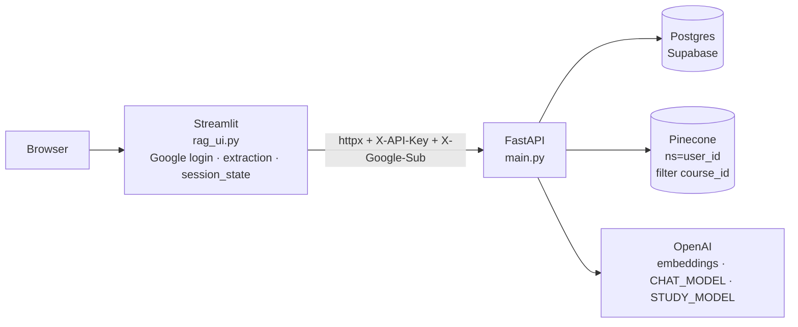

# Adaptive Study Agent — Architecture Cheatsheet

Commit `d7f0bfd`. Full explanations: `PROJECT_TECHNICAL_WALKTHROUGH.md`.

---

## Architecture



**Rule of thumb:** the LLM writes text and a raw score; Python decides retrieval, selection, verdict, mastery, storage and access.

---

## File / function map

| File | Key functions | Role |
|---|---|---|
| `rag_ui.py` | `api_request` 111, `auth_headers` 97, `extract_pdf_text` 156, `render_ask_result` 190, `render_grade_result` 204, `render_past_questions` 279, `reset_quiz_state` 308; page 317–625 | UI, login, extraction, state |
| `main.py` | `current_user` 68, `require_course` 92, `service_error` 97, `call_model_structured` 184; endpoints 204–355 | API |
| `users.py` | `ensure_user` 3 | Google `sub` → user UUID |
| `courses.py` | `create_course` 4, `list_courses` 24, `user_owns_course` 50, `archive_course` 69 | Courses (soft delete) |
| `documents.py` | `list_documents` 5, `delete_document` 35 | Materials (soft delete + vector delete) |
| `ingest.py` | `get_text_splitter` 24, `ingest_document` 35 | Hash, chunk, rows, upsert, versioning |
| `vectorstore.py` | `get_embeddings` 59, `get_vector_store` 101, `delete_vectors` 186 | Pinecone + embeddings |
| `retrieve.py` | `retrieve_chunks` 14 | k-NN search |
| `rag.py` | `GROUNDING_PROMPT_TEMPLATE` 9, `_format_chunk` 23, `build_grounding_prompt` 31 | Ask prompt |
| `memory_store.py` | `normalize_topic` 6, `get_or_create_topic` 9 | Topics |
| `study.py` | `QUIZ_PROMPT` 29, `GRADE_PROMPT` 48, `QuizDraft` 97, `GradeDraft` 106, `verdict_from_score` 115, `save_question` 141, `_call_structured` 226, `generate_quiz_question` 269, `load_question_for_grading` 367, `record_attempt` 434, `grade_student_answer` 564, `get_question_candidates` 661, `get_topic_mastery` 700, `select_next_question` 722 | Quiz, grading, mastery, selection |
| `adaptive.py` | `update_mastery` 3, `next_due` 6 (unused), `recency_penalty` 17, `priority_score` 28 | Maths |
| `questions.py` | `list_questions` 6 | Past questions |
| `db.py` | `get_conn` 11 | New connection per call |

---

## Endpoint map

| Endpoint | Handler | Core call | Model? |
|---|---|---|---|
| `GET /health` | `health` | — | — |
| `POST /courses` `{name}` | `create_course_endpoint` | `create_course` | — |
| `GET /courses` | `list_courses_endpoint` | `list_courses` (newest first) | — |
| `DELETE /courses/{id}` | `delete_course_endpoint` | `archive_course` | — |
| `POST /ingest` `{course_id, filename, text}` | `ingest` | `ingest_document` | embeddings |
| `GET /documents?course_id` | `documents` | `list_documents` | — |
| `DELETE /documents/{id}` | `remove_document` | `delete_document` | — |
| `GET /questions?course_id` | `questions` | `list_questions` | — |
| `POST /quiz` `{course_id, topic}` | `quiz` | `generate_quiz_question` | embeddings + `STUDY_MODEL` (only when generating) |
| `POST /grade` `{question_id, answer}` | `grade` | `grade_student_answer` | `STUDY_MODEL` |
| `POST /ask` `{course_id, question}` | `ask` | `retrieve_chunks` → `call_model_structured` | embeddings + `CHAT_MODEL` |

Errors: 400 validation · 401 auth · 404 not owned/not found · 422 Pydantic · 503 model/vector failure · 500 anything uncaught.

---

## Data model

```text
users ─┬─ user_identities (unique provider+subject)
       └─ courses (archived_at) ─┬─ documents (status, deleted_at, content_hash) ── chunks (id = Pinecone id)
                                 ├─ topics (unique course_id+normalized_key)
                                 └─ questions (prompt, reference_answer, key_points, concept_label, status)
                                       ├─ question_topics (is_primary)
                                       ├─ question_sources → chunks (rank)
                                       ├─ attempts (append-only history)
                                       └─ question_state (PK user_id+question_id: mastery, attempt_count,
                                                          correct_streak, last_score, last_attempt_at)
```

- Every table has `user_id`. FKs are `ON DELETE RESTRICT`. RLS on, no policies.
- Never written: `questions.difficulty`, `questions.generation`, `question_state.next_due_at`, `usage_daily`.
- No unique course names; no attempt idempotency key; no migrations.

**Postgres vs Pinecone:** Postgres = source of truth (text, history, progress). Pinecone = derived vector index; record = `{id: chunk_id, values: 1536 floats, metadata: {chunk_id, document_id, course_id, chunk_index, source, text}}`, namespace = user UUID.

---

## Important algorithms

| Algorithm | Detail |
|---|---|
| Extraction | pypdf page text, empty pages dropped, pages joined with `\n\n`; TXT utf-8 with replacement. Original file not stored |
| Normalisation | `.strip()` only |
| Dedup / versioning | sha256(text); same filename+hash → `unchanged`; same filename, new hash → new version, old `replaced` |
| Chunking | `RecursiveCharacterTextSplitter(chunk_size=800, chunk_overlap=100, add_start_index=True)`; separators `\n\n`, `\n`, space, char; lengths in characters; overlap = whole trailing pieces ≤ 100 chars (often 0 at paragraph cuts) |
| Embedding | `text-embedding-3-small`, 1536-d, unit length |
| Retrieval | cosine top-k, **k = 5**, namespace user, filter course; **no threshold**; query = question (Ask) or topic string (Quiz) |
| Context format | `[Source: <filename>]\n<chunk>` joined by blank lines; no ids |
| Structured output | `chat.completions.parse(response_format=<Pydantic model>)` |
| Retries | Quiz/Grade: 2 tries on `ValueError`/`APIError` then 503; Ask: none |
| Topic key | `" ".join(topic.split()).casefold()` |

---

## Scoring formulas (grading)

| Rule | Value |
|---|---|
| Raw score | **LLM**, 0.0–1.0 |
| Clamp | `score = max(0, min(1, score))` |
| Verdict (Python) | `≥ 0.85` correct · `≥ 0.35` partially_correct · else incorrect |
| No grade | `sufficient_material=false` or `score=None` → no attempt |
| Gap | dropped when verdict is correct |
| Stored | `attempts`: answer, verdict, score, missed_points, feedback, explanation, identified_gap, grader_model, `grader_version='v1'` |
| Feedback reuse | `missed_points`, `identified_gap` shown once, **never read again** |

---

## Adaptive-learning rules

| Rule | Formula |
|---|---|
| Mastery update | `m = 0.6·m_prev + 0.4·score`, `m_0 = 0.5` (EWMA, α = 0.4) |
| First answer range | 0.30 (score 0) … 0.70 (score 1) |
| Streak | `+1` if correct else `0` (stored, unused) |
| Topic mastery | `AVG(question_state.mastery)` over answered questions in the topic; 0.5 if none |
| Recency penalty | `0.5 · max(0, 1 − hours_since/24)` |
| Priority (answered) | `mastery + recency_penalty` |
| Priority (unanswered) | `0.5 · topic_mastery` |
| New-question priority | `0.5 · topic_mastery` |
| Decision | lowest priority wins; unanswered ties → existing; `new < best` → generate; else existing |
| In practice | keeps generating new questions; an old one returns only if `mastery + penalty < 0.5·topic_mastery` (e.g. 4 strong + 1 weak, after ~24 h) |
| Not implemented | difficulty, spaced repetition (`next_due`), gaps fed into generation, automatic topic choice, learned models |

Reference values: 3×wrong on one question → 0.108; 3×right → 0.892.

---

## External service dependencies

| Service | Config | Used by |
|---|---|---|
| Supabase Postgres | `DATABASE_URL` | all data modules |
| Pinecone | `PINECONE_API_KEY`, `PINECONE_INDEX_NAME`, `PINECONE_AUTO_CREATE_INDEX`, `PINECONE_CLOUD/REGION` | `vectorstore.py`, `ingest.py`, `retrieve.py`, `documents.py` |
| OpenAI embeddings | `OPENAI_API_KEY`, `OPENAI_EMBEDDING_MODEL` (default `text-embedding-3-small`) | `vectorstore.py` |
| OpenAI chat (Ask) | `CHAT_MODEL` (default `gpt-5-mini`; must be in the price table) | `main.py` |
| OpenAI chat (Quiz/Grade) | `STUDY_MODEL` (default `gpt-4o-mini`) | `study.py` |
| Google OIDC | Streamlit `[auth]` secrets | `rag_ui.py` |
| API trust | `API_SHARED_SECRET` (both sides), `ALLOW_DEV_USER`, `RENDER`/`APP_ENV` | `main.py`, `rag_ui.py` |
| Ingest tuning | `INGEST_CHUNK_SIZE` (800), `INGEST_CHUNK_OVERLAP` (100) | `ingest.py` |
| UI → API | `RAG_API_URL`, 120 s timeout | `rag_ui.py` |

---

## Reading order

`schema.sql` → `db.py`, `users.py` → `main.py` → `courses.py`, `documents.py` → `vectorstore.py`, `ingest.py` → `retrieve.py`, `rag.py` → `memory_store.py` → `adaptive.py`, `test_adaptive.py` → `study.py` (prompts → schemas → `_call_structured` → `generate_quiz_question` → selection → grading → `record_attempt` → `save_question`) → `questions.py` → `rag_ui.py` → `evals/golden/`. Skip `course/` and `AGENTS.md` (archived project).
