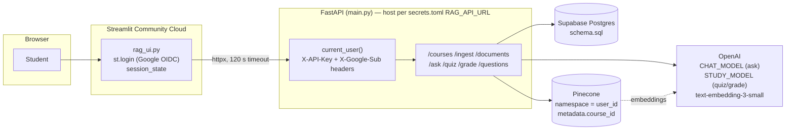
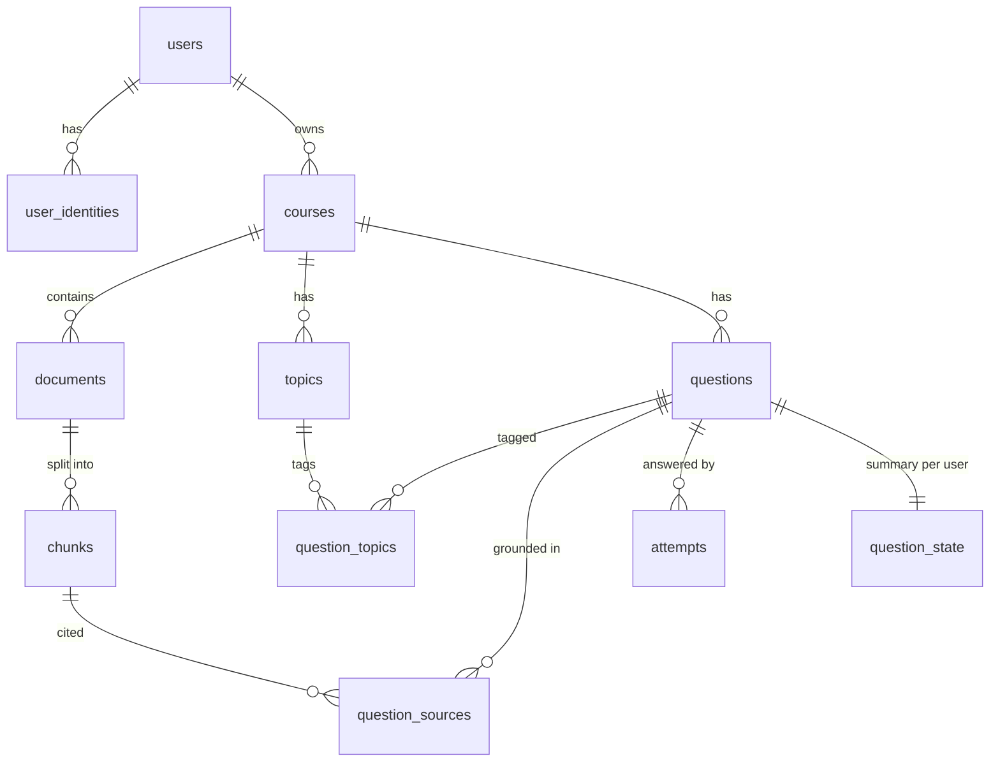

# Codebase Analysis — 2026-10-26

**Repository:** `sarahrandhawa/adaptive-study-agent` @ `d7f0bfd` ("Added Dev Container Folder"), 7 commits on `main`.
**Scope:** Diagnostic only. No application code, schema, data or deployment settings were changed. No production database or live service was queried.
**Primary bug source:** `USER_EXPERIENCE_AUDIT.md` (Oct 26 audit bundle, not in this repository).

All line numbers refer to commit `d7f0bfd`.

---

## 1. Repository layout

The working application is ~2,100 lines of Python in the repository root. Everything under `course/` is archived coursework (a "Northwind FAQ" agent and stage servers) and is **not imported by the app**.

| File | Lines | Role (verified by reading the code) |
|---|---|---|
| `main.py` | 355 | FastAPI app: auth dependency, request/response schemas, all HTTP endpoints, `/ask` model call |
| `rag_ui.py` | 625 | Streamlit front end: Google login, course picker, upload, Ask, Quiz, Past questions. Talks to the API over HTTP only |
| `study.py` | 780 | Quiz generation, grading prompts, attempt recording, mastery update, adaptive question selection |
| `adaptive.py` | 41 | Pure functions: `update_mastery`, `priority_score`, `recency_penalty`, `next_due` (unused) |
| `courses.py` | 86 | Course create / list / ownership check / archive |
| `documents.py` | 91 | Document list and soft delete (+ Pinecone vector delete) |
| `ingest.py` | 256 | Chunking, Postgres document/chunk rows, Pinecone upsert, replace-by-filename |
| `retrieve.py` | 60 | Pinecone similarity search filtered by `course_id` in the user's namespace |
| `rag.py` | 45 | `/ask` grounding prompt and chunk formatting (also used by `study.py`) |
| `vectorstore.py` | 190 | Pinecone client, embeddings, index helpers, `delete_vectors` |
| `memory_store.py` | 41 | Topic upsert (`get_or_create_topic`) — despite the name, not a learning-memory store |
| `questions.py` | 56 | Read-only Past-questions listing |
| `users.py` | 42 | `ensure_user` (Google `sub` → internal user UUID) |
| `db.py` | 15 | `get_conn()` — a new `psycopg.connect` per call, no pooling |
| `schema.sql` | 140 | The only schema definition. No migrations directory, no indexes beyond PK/UNIQUE |
| `test_adaptive.py` | 71 | Pure unit tests for `adaptive.py` |
| `test_attempt_persistence.py` | 55 | Reads a live database for a hard-coded question ID |
| `evals/golden/` | — | Labeled-later eval data for quiz/grade/ask; the runner it references (`evals/run_golden.py`) does not exist |
| `check_db_connection.py` | 13 | Manual connectivity script |

Documentation drift worth knowing about:
- `AGENTS.md` describes "Northwind FAQ Agent Rules" (the archived course project), not this app.
- `README.md` calls `memory_store.py` "Student learning memory"; it only creates topic rows.
- `README.md` lists "Generate quizzes" — the app generates **one** short-answer question per request.

---

## 2. Runtime architecture



**Trust model.** Streamlit authenticates the user with Google (`st.login`, `rag_ui.py:320-325`). The API never sees a Google token; it trusts identity headers (`X-Google-Sub`, `X-User-Email`, `X-User-Name`) when they arrive with the shared secret `X-API-Key` (`main.py:68-89`). The API refuses to start without the secret only when `RENDER=true` or `APP_ENV=production` (`main.py:41-49`).

**Two model settings.** `/ask` uses `CHAT_MODEL` (default `gpt-5-mini`, `main.py:58`). Quiz generation and grading use `STUDY_MODEL` (default `gpt-4o-mini`, `study.py:27`). The deployed values cannot be verified from the repository.

**Connections.** Every DB helper opens its own connection (`db.py:11-15`). A single `/grade` request opens at least three: `ensure_user`, `load_question_for_grading`, `record_attempt`.

---

## 3. Data model (`schema.sql`)



Observations (all confirmed by reading `schema.sql`):

| Table | Notable constraints | Missing |
|---|---|---|
| `courses` | PK only; soft delete via `archived_at` | No uniqueness on `(user_id, name)`; `name` nullable |
| `documents` | Soft delete via `status`/`deleted_at` | No uniqueness on `(course_id, filename, content_hash)` |
| `topics` | `unique(course_id, normalized_key)` | — |
| `questions` | — | No `source`/validation status; `generation` jsonb column exists but is never written |
| `attempts` | Append-only history | No idempotency key; no uniqueness of any kind |
| `question_state` | PK `(user_id, question_id)` | `next_due_at` exists but is never written |
| all tables | `ON DELETE RESTRICT` FKs; RLS enabled | No RLS policies (fine for a backend role that bypasses RLS; denies anon/authenticated) ; no secondary indexes; most columns nullable |

There is no migration tooling. Whether production matches `schema.sql` cannot be confirmed without inspecting the database.

---

## 4. Request flows by responsibility

### 4.1 Course creation and deletion

```mermaid
sequenceDiagram
    participant UI as rag_ui.py
    participant API as main.py
    participant C as courses.py
    participant DB as Postgres
    UI->>API: POST /courses {name}
    API->>C: create_course(user_id, name)  (strip only)
    C->>DB: INSERT courses (no uniqueness check)
    API->>C: list_courses → find new id
    API-->>UI: CourseResponse
    UI->>UI: session_state.pending_course_id = id; rerun
    Note over UI: selectbox(options=ids, format_func=name)<br/>Streamlit serialises the selection by LABEL
    UI->>API: DELETE /courses/{selected_course_id}
    API->>C: archive_course → UPDATE courses SET archived_at
    Note over DB: documents, chunks, questions, attempts<br/>and Pinecone vectors are all kept
```

- Create: `rag_ui.py:388-404` → `main.py:209-220` → `courses.py:4-21`.
- List: `courses.py:24-47`, ordered `created_at DESC`.
- Picker: `rag_ui.py:352-371`.
- Delete: `rag_ui.py:406-433` → `main.py:228-235` → `courses.py:69-86` (soft delete).
- The UI warning says the course disappears "along with its materials, questions and progress" (`rag_ui.py:415-416`); the backend keeps all of them (`main.py:230`), including Pinecone vectors.

### 4.2 Document ingestion and retrieval

- UI extracts text locally (pypdf / UTF-8) and posts plain text: `rag_ui.py:445-482`.
- `/ingest` → `ingest.py:35-257`: ownership check, duplicate check by `(filename, content_hash)`, insert `documents` + `chunks`, upsert to Pinecone **inside the open DB transaction**, then retire an older same-filename version.
- Retrieval: `retrieve.py:14-61` → Pinecone namespace `str(user_id)`, filter `{"course_id": ...}`, `k=5` (`rag.py:7`). No similarity threshold — any course with vectors always returns up to 5 chunks.

### 4.3 Quiz question generation

`rag_ui.py:528-566` → `main.py:280-295` → `study.py:269-365`:

1. `get_or_create_topic` normalises the topic string per course (`memory_store.py:6-41`).
2. `select_next_question` decides **reuse** vs **generate** (`study.py:722-780`, using `adaptive.priority_score`).
3. Generate path: `retrieve_chunks(query=topic)` → `QUIZ_PROMPT` (`study.py:29-46`) → one structured call returns question **and** reference answer **and** key points **and** concept label (`QuizDraft`, `study.py:97-103`).
4. `save_question` stores the draft and links all retrieved chunks as sources (`study.py:141-224`). **No step checks the draft against the chunks.**

### 4.4 Answer submission, grading and mastery

`rag_ui.py:575-615` → `main.py:298-311` → `study.py:564-659`:

1. Strip; reject empty (`study.py:571-574`; also `GradeRequest.answer min_length=1`, `main.py:143-145`).
2. Load question, stored reference answer, key points and source chunks (`study.py:367-432`).
3. `GRADE_PROMPT` (`study.py:48-86`) → `GradeDraft` (score, missed points, feedback…).
4. Clamp score, derive verdict deterministically (`study.py:115-120`, `615-619`).
5. `record_attempt` (`study.py:434-562`): read `question_state`, compute `update_mastery(old, score) = 0.6·old + 0.4·score` (`adaptive.py:3-4`), insert `attempts`, upsert `question_state`. One transaction, **no row lock and no idempotency key**.

### 4.5 Adaptive selection

`select_next_question` (`study.py:722-780`): candidates are all active questions for the topic; priority = question mastery + recency penalty (max 0.5, decays over 24 h); new-question priority = `0.5 × topic mastery`. Lowest priority wins. `next_due()` (`adaptive.py:6-15`) and `question_state.next_due_at` are unused.

### 4.6 Persistence across sessions

Durable: courses, documents, chunks, topics, questions, attempts, question_state (Postgres) and vectors (Pinecone). Not durable: Ask questions/answers, current quiz question, typed text (Streamlit `session_state` only). The audit confirmed durable state survives reload, new tab and logout → login.

---

## 5. Responsibility map and overlaps

| Responsibility | Owner | Overlap / leak |
|---|---|---|
| Authentication | Streamlit (`st.login`) | API trusts headers; correctness depends on the shared secret being set wherever the API runs |
| User ↔ course ownership | `courses.user_owns_course`, re-implemented inline in `ingest.py:56-69` | `/grade` checks question ownership only, not that the course is still active |
| Input validation | Pydantic in `main.py`, re-done in `study.py`/`ingest.py`, and again in `rag_ui.py` | Three layers with different rules (e.g. Pydantic `min_length=1` accepts `" "`; `study.py` strips first) |
| Course selection state | `rag_ui.py` (`selected_course_id`, `active_course_id`, `pending_course_id`) | Selection resolved by display label inside Streamlit, not by ID |
| Question truth (question + reference + key points) | One LLM call in `study.py` | Same artefact is later treated as ground truth by the grader |
| Scoring | LLM produces a holistic score; code derives verdict | No deterministic per-key-point check |
| Mastery | `adaptive.update_mastery` called from `study.record_attempt` | No idempotency; every recorded attempt moves mastery |
| Vector/DB consistency | `ingest.py`, `documents.py` | Pinecone side effects happen inside DB transactions with no compensation |

---

## 6. External dependencies

| Service | Used by | Configuration |
|---|---|---|
| Supabase Postgres | all data modules | `DATABASE_URL` (session pooler) |
| Pinecone | `vectorstore.py`, `retrieve.py`, `ingest.py`, `documents.py` | `PINECONE_API_KEY`, `PINECONE_INDEX_NAME`, optional auto-create |
| OpenAI chat | `main.py` (`CHAT_MODEL`), `study.py` (`STUDY_MODEL`) | Module-level `OpenAI()` clients created at import (`main.py:57`, `study.py:26`) |
| OpenAI embeddings | `vectorstore.py:58-62` | `OPENAI_EMBEDDING_MODEL`, default `text-embedding-3-small` |
| Google OIDC | `rag_ui.py` via `st.login` | `[auth]` in Streamlit secrets |

Dependency pins (`requirements.txt`): `streamlit>=1.42` and `fastapi[standard]` are unpinned at the top end, so the deployed versions are whatever was resolved at last build. No `pytest` or other test tooling is listed.

---

## 7. Architectural weaknesses

Ordered by impact. "Confirmed" means demonstrated by code reading (and, where noted, by the audit's observed numbers).

1. **Generated questions are trusted without verification (confirmed).** Question, reference answer and key points come from one unchecked LLM call and are then the grader's ground truth. A single generation error propagates into the question, the grading and the student's mastery. Root of B4 and a contributor to B5/B6.
2. **Attempt recording is not idempotent and not concurrency-safe (confirmed).** Any repeat or retry of `/grade` creates a new attempt and moves mastery; concurrent requests can lose an update (read-then-write without `FOR UPDATE`, `study.py:451-458`). Root of B2.
3. **UI identity by display label (confirmed).** Courses are IDs in Python, but Streamlit's selectbox resolves the browser's selection by formatted label, last duplicate wins. Combined with no name uniqueness, a course becomes unreachable and the Delete target is wrong. Root of B1.
4. **External side effects inside DB transactions (confirmed in code; impact not observed).** `ingest.py:216-224` upserts to Pinecone before the transaction commits; `documents.py:66-69` deletes vectors before the soft-delete commits. A commit failure leaves Pinecone and Postgres disagreeing.
5. **Streamlit widget state inside forms is mutated programmatically (confirmed pattern; failure mode is a strong hypothesis).** `quiz_answer` is both a form widget key and reset in code (`rag_ui.py:312`, `556`, `577-583`). Most likely route for B3.
6. **All tabs execute on every rerun (confirmed).** `st.tabs` runs every tab body, so each interaction calls `/courses`, `/documents` and `/questions` (each also running `ensure_user`), with a new DB connection per helper. This is why stale content lingers (B8) and a large part of the observed latency.
7. **Soft delete is presented as hard delete (confirmed).** Archived courses keep materials, attempts and vectors, while the UI says they are removed. A privacy and expectation mismatch.
8. **No migrations, few constraints, no test harness, no CI (confirmed).** Fixes that need constraints (B1, B2) need a migration path first; regressions currently have nothing to catch them.
9. **Auth depends on deployment flags (potential).** If the API runs somewhere that sets neither `RENDER` nor `APP_ENV=production` and `API_SHARED_SECRET` is empty, any caller can impersonate any user via `X-Google-Sub`. Needs confirmation of the deployed settings.
