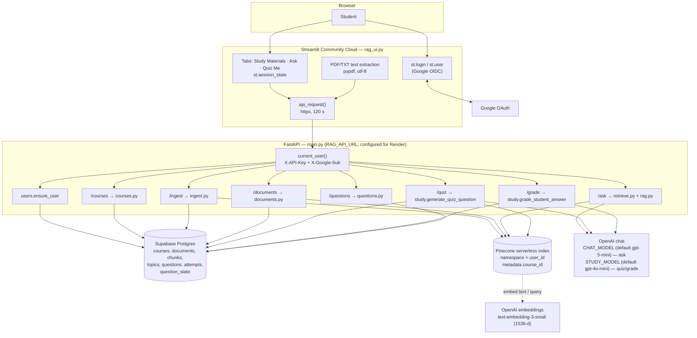
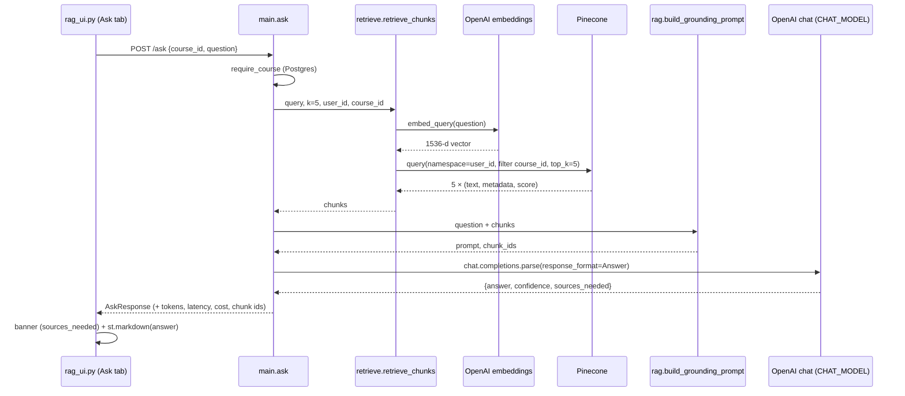
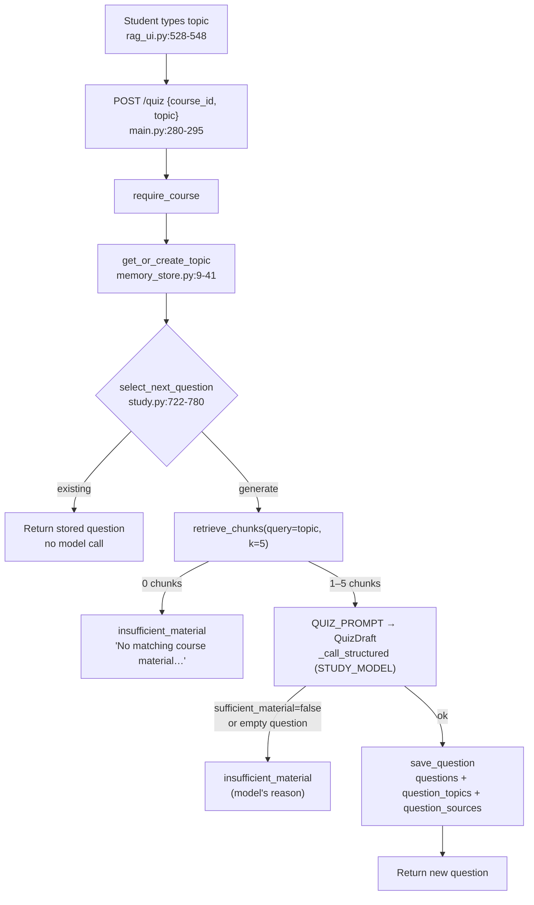
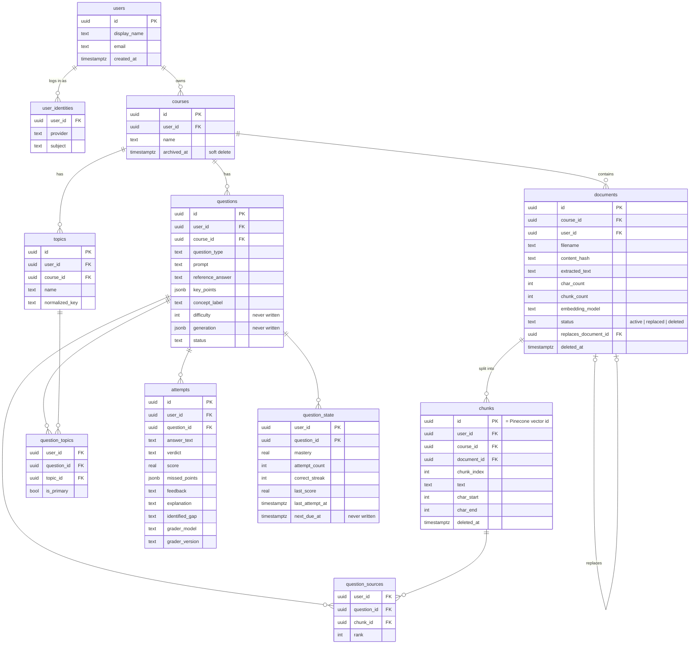

# Adaptive Study Agent — Technical Walkthrough

**Purpose:** rebuild a precise mental model of the application from its source code.
**Source of truth:** commit `d7f0bfd` on `main`. File paths and line numbers refer to that commit.
**Verification used for this document:**
- Every claim was traced in the code; where behaviour depends on a library, the library's source was read (Streamlit selectbox serialisation, LangChain's `RecursiveCharacterTextSplitter`).
- The chunking examples in Part 2 are real output from LangChain's splitter source run with the app's settings.
- The selection examples in Part 6 are produced by replaying `select_next_question`'s decision rule with the real `adaptive.py`.
- No live service, database or model was called.

Each major section ends with **"Explain it yourself"** — one thing you should be able to describe without the code open.

---

## Contents

1. High-level architecture
2. Following a document through the system
3. Question answering (RAG)
4. Quiz generation
5. Answer grading and scoring
6. Mastery tracking and adaptive learning
7. Database, state and persistence
8. A complete learning session, end to end
9. Engineering trade-offs and weaknesses
10. Technical interview preparation
11. Suggested reading order for the source

---

## Part 1 — High-level architecture

### 1.1 What the application does

A student signs in with Google, creates a course, uploads PDF or TXT notes, and then:

- **asks questions** answered only from those notes, with the source file named;
- **requests practice questions** on a topic they type; each is a single short-answer question generated from the notes;
- **submits answers** and gets a score, feedback and a per-question mastery percentage;
- sees **past questions** with their attempt counts and mastery.

"Adaptive" in the current code means one thing precisely: when you ask for a question on a topic, a rule decides whether to show a question you've seen before or generate a new one, based on your per-question mastery and how recently you answered (Part 6). The question generator itself receives no information about your performance.

### 1.2 Components at a glance



### 1.3 Component map

| Component | Files and functions | Endpoints | Deterministic or LLM |
|---|---|---|---|
| Streamlit front end | `rag_ui.py` (whole file); helpers `api_request` 111, `extract_uploaded_text` 169, `render_*` 180–305 | calls all below | Deterministic |
| FastAPI back end | `main.py` | see §1.4 | Deterministic, except `/ask` model call |
| Authentication | `rag_ui.py:97-108,320-330`; `main.py:68-89`; `users.py:3-42` | every endpoint (`Depends(current_user)`) | Deterministic |
| Database access | `db.py:11-15` plus SQL in each module | — | Deterministic |
| Document ingestion | `rag_ui.py:445-482` (extraction), `ingest.py:35-257` | `POST /ingest` | Deterministic (embedding is a model, but a deterministic function of the text) |
| Chunking | `ingest.py:24-32,47-51` (`RecursiveCharacterTextSplitter`) | — | Deterministic |
| Embeddings | `vectorstore.py:58-62` (`OpenAIEmbeddings`) | — | Neural model; same input → (practically) same vector |
| Vector storage | `vectorstore.py:94-106,186-190`; `ingest.py:216-224` | — | Deterministic |
| Retrieval | `retrieve.py:14-61` | used by `/ask`, `/quiz` | Deterministic given the vectors |
| RAG answer | `rag.py:9-45`; `main.py:184-201,314-355` | `POST /ask` | **LLM** |
| Quiz generation | `study.py:29-46,97-103,256-365` | `POST /quiz` | **LLM** (question, reference, key points, concept label) |
| Question selection | `study.py:661-780`; `adaptive.py:17-41` | `POST /quiz` | Deterministic rule |
| Grading | `study.py:48-86,106-120,564-659` | `POST /grade` | **LLM score**; deterministic clamp, verdict and mastery |
| Mastery | `adaptive.py:3-4`; `study.py:434-562` | `POST /grade` | Deterministic formula |
| Topic normalisation | `memory_store.py:6-41` | `POST /quiz` | Deterministic |
| History listing | `questions.py:6-56` | `GET /questions` | Deterministic |

### 1.4 Endpoint map

| Method & path | Handler (`main.py`) | Request | Response | Calls |
|---|---|---|---|---|
| `GET /health` | `health` 204 | — | `{"status":"ok"}` | — |
| `POST /courses` | `create_course_endpoint` 209 | `{name}` | `CourseResponse {id,name,created_at}` | `create_course`, `list_courses` |
| `GET /courses` | `list_courses_endpoint` 223 | — | `[CourseResponse]` newest first | `list_courses` |
| `DELETE /courses/{course_id}` | `delete_course_endpoint` 228 | path UUID | `{"status":"deleted"}` / 404 | `archive_course` (soft) |
| `POST /ingest` | `ingest` 238 | `{course_id, filename, text}` | `{document_id, chunks_indexed, status}` | `ingest_document` |
| `GET /documents?course_id=` | `documents` 255 | query UUID | `[DocumentResponse]` | `require_course`, `list_documents` |
| `DELETE /documents/{document_id}` | `remove_document` 261 | path UUID | `{"status":"deleted"}` / 404 | `delete_document` |
| `GET /questions?course_id=` | `questions` 274 | query UUID | `[QuestionSummary]` | `require_course`, `list_questions` |
| `POST /quiz` | `quiz` 280 | `{course_id, topic}` | `{status, question_id, question, topic, concept_label, mode, topic_mastery, …}` | `generate_quiz_question` |
| `POST /grade` | `grade` 298 | `{question_id, answer}` | `{status, verdict, score, mastery, attempt_count, feedback, …}` | `grade_student_answer` |
| `POST /ask` | `ask` 314 | `{course_id, question}` | `AskResponse {answer{answer,confidence,sources_needed}, tokens_used, model, latency_ms, cost_usd, retrieved_chunk_ids}` | `retrieve_chunks`, `build_grounding_prompt`, `call_model_structured` |

Error mapping is consistent: validation → 400 (or 422 from Pydantic), missing/foreign resource → 404, model or vector-store failure → 503 with a friendly message (`service_error`, `main.py:97-101`). Exceptions not in those lists become plain 500s.

### 1.5 Authentication — how identity flows

1. `rag_ui.py:320-325`: if `st.user.is_logged_in` is false, show "Sign in with Google" and `st.stop()`. `st.login()` runs the OIDC flow configured in `[auth]` secrets; Streamlit then keeps the identity in a signed cookie (signed with `cookie_secret`).
2. `auth_headers()` (`rag_ui.py:97-108`) sends `X-Google-Sub` (Google's stable user id), URL-encoded email and name, and `X-API-Key` (the shared secret).
3. `current_user()` (`main.py:68-89`): if a secret is configured, compare it in constant time (`secrets.compare_digest`); then `ensure_user("google", sub, …)` maps the Google id to an internal UUID, creating `users` + `user_identities` rows on first sight.
4. Every query thereafter filters by that internal `user_id`.

The API never verifies a Google token. It trusts the Streamlit server, which proves itself with the shared secret. That's a reasonable backend-for-frontend pattern **as long as the secret is set**; startup enforces it only when `RENDER=true` or `APP_ENV=production` (`main.py:41-49`).

### 1.6 Deployment architecture

- **Front end:** Streamlit Community Cloud (`*.streamlit.app`), entry point `rag_ui.py`. Secrets: `RAG_API_URL`, `API_SHARED_SECRET`, `[auth]`.
- **API:** a separate service at `RAG_API_URL`. The examples (`.env.example:13`, `.streamlit/secrets.toml.example:3`) and the `RENDER` check point to Render. Started with `uvicorn main:app`.
- **Database:** Supabase Postgres via the session pooler (`DATABASE_URL`).
- **Vectors:** Pinecone serverless index (`PINECONE_INDEX_NAME`; optional auto-create in `aws/us-east-1`, `vectorstore.py:38-91`).
- **Models:** OpenAI, keys only on the API side.
- `.devcontainer/` is for GitHub Codespaces and runs only the Streamlit app.

The deployed model names, Streamlit version and API host aren't in the repository; they live in deployment settings.

### 1.7 Deterministic versus LLM-driven — the one-line version

**The LLM writes text and a raw score. Python decides everything else:** which chunks are retrieved, which question is shown, the verdict label, the mastery number, what is stored, and who can see it.

> **Explain it yourself:** why the API trusts `X-Google-Sub`, and the single setting that makes that safe.

---

## Part 2 — Following a document through the system

Scenario: a student creates "Introduction to Biology" and uploads `unit4_photosynthesis.pdf`.

### 2.0 Creating the course

`rag_ui.py:338-350` (first course) or `388-404` (sidebar) → `POST /courses {"name": "Introduction to Biology"}` → `courses.create_course` (`courses.py:4-21`):

```python
name = name.strip()                       # only normalisation: trim ends
if not name: raise ValueError(...)        # → 400
INSERT INTO courses (user_id, name) VALUES (%s, %s) RETURNING id
```

The UI stores the new id in `session_state.pending_course_id`; on the next run it's copied into the selectbox's key `selected_course_id` (`rag_ui.py:356-358`), selecting the course. Every later request carries this `course_id`.

### 2.1 How the document is received

`rag_ui.py:445-451`:

```python
uploaded_files = st.file_uploader("Choose PDF or TXT files", type=["pdf", "txt"],
                                  accept_multiple_files=True, ...)
```

The browser uploads the file to **the Streamlit server**, not to the API. Streamlit enforces the extension list and its 200 MB default limit. Nothing has happened yet; processing starts only when "Add to study materials" is clicked (`rag_ui.py:453`).

### 2.2 How text is extracted

`rag_ui.py:169-175` dispatches on the extension:

```python
def extract_pdf_text(file_bytes):
    reader = PdfReader(BytesIO(file_bytes))      # pypdf parses the PDF structure
    pages = []
    for page in reader.pages:
        extracted = page.extract_text() or ""    # text layer only; scanned images give ""
        stripped = extracted.strip()
        if stripped:
            pages.append(stripped)               # empty pages are skipped
    return "\n\n".join(pages)                    # pages separated by a blank line

def extract_txt_text(file_bytes):
    return file_bytes.decode("utf-8", errors="replace")   # bad bytes become U+FFFD
```

Two consequences worth remembering:

- **Pages become paragraphs.** Joining pages with `"\n\n"` matters later, because `"\n\n"` is the splitter's first choice of cut point.
- **The original file is never stored.** Only the extracted text leaves the Streamlit server.

If extraction throws, the UI shows "Could not read …" and skips the file (`rag_ui.py:459-463`). If it returns nothing (a scanned PDF, an empty TXT), the UI shows "No readable text…" (`rag_ui.py:465-470`). Both happen before any API call.

### 2.3 How text is cleaned

Very little:

- `rag_ui.py:460`: `.strip()` on the whole extracted text.
- `ingest.py:36-37`: `filename.strip()`, `text.strip()` again on the API side.

No whitespace collapsing, hyphenation repair, header/footer removal or Unicode normalisation. Whatever pypdf produces (including line breaks in the middle of sentences, typical for PDFs) is what gets chunked and embedded.

The API then sends `POST /ingest {"course_id", "filename", "text"}` (`rag_ui.py:473-481`). Pydantic requires non-empty `filename` and `text` (`main.py:126-129`).

### 2.4 Duplicate and version handling (before chunking is stored)

`ingest.py:45`: `content_hash = sha256(text)`. Inside one transaction (`ingest.py:53-257`):

1. **Ownership:** the course must exist, belong to the user, and not be archived (`56-69`) — else 400 "Course not found".
2. **Exact duplicate:** same course, filename **and** hash, still active → return `{"status": "unchanged"}` (`71-93`). The UI shows "… is already in this course."
3. **New version:** same filename, different hash → remember the older document id (`95-111`); it is retired at the end (`227-251`).

### 2.5 How text is divided into chunks

`ingest.py:24-32,47-51`:

```python
def get_text_splitter():
    chunk_size = int(os.getenv("INGEST_CHUNK_SIZE", "800"))      # characters, not tokens
    chunk_overlap = int(os.getenv("INGEST_CHUNK_OVERLAP", "100"))
    return RecursiveCharacterTextSplitter(chunk_size=chunk_size,
                                          chunk_overlap=chunk_overlap,
                                          add_start_index=True)   # record char offset

split_documents = splitter.create_documents([text])
```

### 2.6 The chunking algorithm

`RecursiveCharacterTextSplitter` with default separators `["\n\n", "\n", " ", ""]` (LangChain, `character.py`):

1. Pick the first separator that occurs in the text (normally `"\n\n"`).
2. Split on it. Pieces shorter than `chunk_size` are kept; any piece still longer is split **recursively** with the next separator (`"\n"`, then `" "`, then character by character).
3. **Merge** adjacent pieces greedily into chunks up to `chunk_size` (LangChain `base.py`, `_merge_splits`).
4. When a chunk is emitted, **overlap** is created by keeping the trailing pieces of the previous chunk whose total length is ≤ `chunk_overlap`, and starting the next chunk with them.

Length is `len()` — characters. 800 characters is roughly 150–200 English tokens.

### 2.7 Concrete examples (real output)

These were produced by LangChain's own splitter source with the app's parameters.

**A short paragraph (219 characters), `chunk_size=800`, `chunk_overlap=100`:**

> Photosynthesis converts light energy into chemical energy. It takes place in the chloroplasts of plant cells. Chlorophyll, a green pigment in the thylakoid membranes, absorbs red and blue light and reflects green light.

Result: **1 chunk**, `start=0, end=219`. Anything under 800 characters is one chunk; there is nothing to overlap.

**A 1,182-character unit with five numbered sections separated by blank lines:**

| Chunk | `start_index`–end | Length | Content |
|---|---|---|---|
| 0 | 0–712 | 712 | Title, "1. Overview", "2. Chlorophyll", "3. Light-dependent reactions" |
| 1 | 714–1182 | 468 | "4. Calvin cycle", "5. Limiting factors" |

The splitter cut at the blank line before section 4 because adding section 4 (~250 chars) would have exceeded 800. Notice **there is no overlap**: the two characters between 712 and 714 are the dropped `"\n\n"`. Overlap is made of *whole pieces at the current separator level*; the last piece of chunk 0 (section 3, ~200 chars) is longer than 100, so nothing could be carried over.

**Same paragraph with settings scaled down (`chunk_size=120`, `chunk_overlap=40`) to make overlap visible:**

| Chunk | start–end | Text |
|---|---|---|
| 0 | 0–109 | "Photosynthesis converts light energy into chemical energy. It takes place in the chloroplasts of plant cells." |
| 1 | 74–193 | "in the chloroplasts of plant cells. Chlorophyll, a green pigment in the thylakoid membranes, absorbs red and blue light" |
| 2 | 156–219 | "membranes, absorbs red and blue light and reflects green light." |

With no blank lines or newlines available, the splitter fell back to `" "` and cut between words. Chunk 1 starts 35 characters before chunk 0 ended — that's the overlap.

### 2.8 Why overlap exists

A fact that straddles a cut point would otherwise be split across two vectors, each embedding half of it. Overlap duplicates a little text at boundaries so a sentence near a cut appears whole in at least one chunk. In this app, with paragraph-level cuts, overlap often turns out to be zero (as above), so the real protection comes from cutting at paragraph boundaries in the first place.

### 2.9 Database rows for the document

Still inside the same transaction:

```python
INSERT INTO documents (user_id, course_id, filename, content_hash, extracted_text,
                       char_count, chunk_count, embedding_model, status, replaces_document_id)
VALUES (..., 'active', old_document_id) RETURNING id                          # ingest.py:113-143

for chunk_index, split_document in enumerate(split_documents):               # ingest.py:148-195
    INSERT INTO chunks (user_id, course_id, document_id, chunk_index, text, char_start, char_end)
    RETURNING id                                                              # Postgres gen_random_uuid()
    chunk_ids.append(str(chunk_id))
    pinecone_documents.append(Document(page_content=chunk_text, metadata={
        "chunk_id": str(chunk_id), "document_id": str(document_id),
        "course_id": str(course_id), "chunk_index": chunk_index, "source": filename}))
```

The Postgres chunk UUID becomes the **Pinecone vector id** — that's the join key between the two stores.

### 2.10 How embeddings are generated

`ingest.py:216-224`:

```python
vector_store = get_vector_store(namespace=str(user_id))       # cached per namespace
vector_store.add_documents(documents=pinecone_documents, ids=chunk_ids)
```

`get_vector_store` (`vectorstore.py:100-106`) wraps the Pinecone index with `OpenAIEmbeddings(model="text-embedding-3-small")`. `add_documents` sends each chunk's text to OpenAI's embeddings endpoint in batches and receives one 1,536-dimensional float vector per chunk.

### 2.11 What an embedding represents

An embedding model maps text to a point in a high-dimensional space trained so that texts with similar meaning land near each other. "Chlorophyll absorbs red and blue light" and "Which pigment captures light energy?" end up close even though they share few words. OpenAI's embedding vectors are normalised to length 1, so cosine similarity and dot product rank results identically.

The embedding captures the gist of the whole 800-character chunk, not individual facts — a chunk covering three sections has one vector that sits "between" those topics. That is the main reason chunk size matters for retrieval quality.

### 2.12 How vectors and metadata are stored

One Pinecone record per chunk:

```text
id:        "3f2c…"            (= chunks.id in Postgres)
values:    [0.0123, -0.0441, … 1536 floats]
namespace: "<internal user UUID>"
metadata:  { chunk_id, document_id, course_id, chunk_index, source: "unit4_photosynthesis.pdf",
             text: "<the chunk text>" }   ← LangChain adds the text under the key "text"
```

The chunk text therefore exists in **two** places (Postgres `chunks.text` and Pinecone metadata), and the full document text exists once more in `documents.extracted_text`.

### 2.13 Three kinds of storage — don't mix them up

| Store | What it holds | Used for |
|---|---|---|
| **Original file** | Nowhere. Discarded after extraction on the Streamlit server | — |
| **Postgres (Supabase)** | `documents` (metadata + full extracted text + hash + status), `chunks` (text + offsets) | Listing materials, version/duplicate checks, grading context (`question_sources → chunks`), soft deletion |
| **Pinecone** | One vector + metadata per chunk | Similarity search for Ask and Quiz |

### 2.14 Finishing the upload

If a previous version exists: delete its vectors (`vectorstore.delete_vectors`), mark the old document `replaced` and its chunks deleted (`ingest.py:227-251`). Return `{"document_id", "chunks_indexed": 2, "status": "indexed"}`; `with get_conn()` commits on exit. The UI shows "Added unit4_photosynthesis.pdf." (`rag_ui.py:180-187`).

### 2.15 Isolation between users and courses

| Layer | Mechanism | Where |
|---|---|---|
| Postgres | Every query filters on `user_id` (and `course_id` where relevant) | all data modules |
| Ownership | `user_owns_course` / inline check before course-scoped work | `courses.py:50-66`, `ingest.py:56-69`, `main.py:92-94` |
| Pinecone, user | **Namespace = user UUID.** A query in one namespace cannot see another's vectors | `retrieve.py:30`, `ingest.py:217` |
| Pinecone, course | **Metadata filter** `{"course_id": "<id>"}` on every query | `retrieve.py:32-36` |
| Row-level security | Enabled on all tables, **no policies**. The API's database role bypasses RLS, so isolation is entirely the application's queries | `schema.sql:130-141` |

### 2.16 What happens if ingestion partially fails

The key fact: **the Pinecone upload happens inside the open Postgres transaction**, and the two systems don't share a transaction.

| Failure point | Postgres outcome | Pinecone outcome | What the student sees |
|---|---|---|---|
| Extraction (UI) | nothing | nothing | "Could not read …" |
| Empty text / validation | nothing | nothing | error message |
| Course not owned/archived | rolled back | nothing | "Course not found" |
| OpenAI embedding or Pinecone upsert error before anything is written | rolled back | nothing | "Could not add this file…" (503) **only** for `VectorStoreConfigError`; other library errors become an unhandled 500 → UI falls back to "please try again" |
| Error **part-way through** the upsert batches, or a commit failure **after** the upsert | rolled back (documents/chunks rows vanish) | **some or all vectors remain** with chunk ids that no longer exist | Upload looks failed, but **Ask can still retrieve those chunks** (their text is in metadata). A quiz built on them fails when `question_sources` references a missing `chunks.id` (FK violation → 500) |
| Old-version vectors deleted, then commit fails | old document still `active` | old vectors gone; new vectors present | Old file listed, its content no longer retrievable |

There is no retry, reconciliation or "indexing" status today.

### 2.17 How retrieval finds the chunks later (preview of Part 3)

`retrieve.py:30-36`:

```python
vector_store = get_vector_store(namespace=str(user_id))
results = vector_store.similarity_search_with_score(normalized_query, k=k,
                                                     filter={"course_id": str(course_id)})
```

The query text is embedded with the same model, Pinecone returns the `k=5` nearest vectors in that user's namespace whose `course_id` matches, and each is turned into a dict `{chunk_id, score, document_id, chunk_index, source, text}` (`retrieve.py:42-54`).

### 2.18 How retrieved text reaches the LLM

`rag._format_chunk` (`rag.py:23-28`) turns each chunk into:

```text
[Source: unit4_photosynthesis.pdf]
Photosynthesis converts light energy into chemical energy. …
```

Chunks are joined with a blank line and inserted into a prompt template (Ask, Quiz and Grade each have their own). Only the filename is shown to the model — ids are deliberately kept out so they can't leak into answers.

> **Explain it yourself:** why the Postgres chunk UUID is reused as the Pinecone vector id, and what goes wrong if the Pinecone write succeeds but the Postgres transaction rolls back.

---

## Part 3 — Question answering (RAG)

Question: **"What is the role of chlorophyll in photosynthesis?"**

### 3.1 Concept

Retrieval-augmented generation answers from *your* documents by (1) finding the passages most similar to the question, and (2) giving only those passages to a language model with instructions to answer from them. The model's general knowledge is still there — the prompt asks it not to use it.

### 3.2 Lifecycle



### 3.3 Step by step

**Front end** (`rag_ui.py:494-515`). The question box is inside `st.form("ask_form")`, so typing doesn't rerun the app; pressing Enter or "Ask" does. Empty/whitespace → "Type a question first." Otherwise `POST /ask {"course_id": selected_course_id, "question": question}` under a spinner.

**Endpoint** (`main.py:314-355`). `AskRequest` requires `course_id: UUID` and `1 ≤ len(question) ≤ 1000` (`main.py:112-114`). `require_course` → 404 if the course isn't the user's or is archived.

**Query preprocessing** (`retrieve.py:21-27`): `.strip()`, reject empty, `k ≥ 1`. No rewriting, expansion or spell-correction — the student's sentence is embedded as typed.

**Query embedding:** `similarity_search_with_score` embeds the question with `text-embedding-3-small`.

**Similarity search and ranking.** Pinecone's index metric is cosine (`vectorstore.py:16`, used when auto-creating). For unit vectors:

$$\text{cos}(q, c) = \frac{q \cdot c}{\lVert q\rVert\,\lVert c\rVert} = q \cdot c \in [-1, 1]$$

Pinecone returns the top 5 by similarity, highest first; LangChain passes the score through as `score` (higher = more similar). The absolute values depend on the embedding model, so only the ranking is meaningful without calibration — and the app uses only the ranking.

**There is no similarity threshold.** If a course has any vectors, five chunks always come back, however unrelated. The only time retrieval is empty is a course with no indexed material. That's why off-topic questions are refused by the *model* ("there isn't enough…"), not by retrieval.

**Retrieved context.** For our biology course, the "2. Chlorophyll" text sits in chunk 0 together with the overview and light reactions; it is very likely the top hit, followed by chunk 1. The course only has 2 chunks, so `k=5` returns both.

**Prompt construction** (`rag.py:9-20,31-45`):

```text
You are a grounded Q&A assistant. Answer the user's question using ONLY the retrieved context below.

Rules:
- Use ONLY information from the retrieved context. Do not use outside knowledge.
- If you cite where information came from, use only the source file name shown in the context header (for example: (from biology-notes.pdf)).
- Never include internal IDs, codes or bracketed identifiers in your answer.
- If the retrieved context is insufficient to answer the question, say so clearly in your answer, use a low confidence score, and set sources_needed to true.

Retrieved context:
[Source: unit4_photosynthesis.pdf]
Introduction to Biology - Unit 4: Photosynthesis … 2. Chlorophyll … absorbs red and blue light …

[Source: unit4_photosynthesis.pdf]
4. Calvin cycle …

Question: What is the role of chlorophyll in photosynthesis?
```

The whole thing is sent as one **user** message — there is no system message.

**LLM invocation and structured parsing** (`main.py:184-201`):

```python
completion = client.chat.completions.parse(model=model, messages=[...], response_format=Answer)
parsed = completion.choices[0].message.parsed      # an Answer instance or None
```

`response_format=Answer` uses OpenAI **structured outputs**: the Pydantic model is converted to a JSON Schema and the model's decoding is constrained to match it, so you get exactly:

```python
class Answer(BaseModel):            # main.py:104-109
    answer: str
    confidence: float = Field(ge=0.0, le=1.0)
    sources_needed: bool
```

`parsed is None` (e.g. the model refused) → `ValueError` → 503 "The AI service had a problem answering." `ValidationError`, `ValueError` and `APIError` are mapped to 503; **there is no retry on `/ask`**.

The response also carries `tokens_used`, `latency_ms`, `cost_usd` (from the hard-coded price table, `main.py:59-62,178-181`) and `retrieved_chunk_ids`. The UI ignores all four, and ignores `confidence`.

**Citations.** There is no citation mechanism in code. The model writes "(from unit4_photosynthesis.pdf)" because the prompt shows `[Source: …]` headers and asks it to. Citations are unverified text: a model could cite the wrong file and nothing would notice.

**Rendering** (`rag_ui.py:190-201`): `sources_needed=true` → yellow "There isn't enough in your uploaded notes to answer that."; else green "Answer from your notes". Then `st.markdown(answer_text)` inside a bordered container. The answer is not stored anywhere.

### 3.4 Hallucination safeguards — present and missing

| Present | Missing |
|---|---|
| Instruction-only grounding ("Use ONLY…") | No check that answer sentences are supported by the chunks |
| Model sees only the user's own course chunks | No similarity threshold; irrelevant chunks always sent |
| Schema-constrained output; `sources_needed` flag | `confidence` is generated, uncalibrated and unused |
| Filenames only in context (no ids to leak) | Citations aren't verified or linked to chunks |
| Empty-course case says "no retrieved context" | Ask makes a model call even when retrieval is empty |
| — | `sources_needed` is a single boolean, so a partial answer shows the "not enough" banner (seen in the Oct 26 audit) |

> **Explain it yourself:** why an off-topic question still sends five chunks to the model, and which component is actually responsible for refusing it.

---

## Part 4 — Quiz generation

### 4.1 Concept

The app produces **one short-answer question at a time**. A question is a stored artefact with its own reference answer and key points, so it can be graded later and re-served. Generation is retrieval-augmented, exactly like Ask: retrieve chunks for the topic, then ask the model to write a question from only those chunks.

### 4.2 Flow



### 4.3 How the topic is chosen

The student types it. Nothing suggests or infers topics. `generate_quiz_question` strips it (`study.py:276-279`), then `get_or_create_topic` normalises it:

```python
def normalize_topic(topic):                       # memory_store.py:6-7
    return " ".join(topic.split()).casefold()      # collapse whitespace, case-fold

INSERT INTO topics (user_id, course_id, name, normalized_key, created_by)
VALUES (..., 'user')
ON CONFLICT (course_id, normalized_key)
DO UPDATE SET name = topics.name                  # no-op update so RETURNING works
RETURNING id                                      # memory_store.py:16-41
```

"Saltwort Crisis", "saltwort  crisis" and "SALTWORT CRISIS" are one topic. "The Saltwort Crisis" is a different topic — there's no semantic matching. The `DO UPDATE SET name = topics.name` trick exists because `ON CONFLICT DO NOTHING` returns no row; the dummy update makes `RETURNING id` work for both insert and existing.

### 4.4 Selection decides whether generation happens at all

`select_next_question` (detailed in Part 6) returns either `mode="existing"` (serve a stored question, no model call, `study.py:298-310`) or `mode="generate"`. **This is the only place performance influences the quiz.**

### 4.5 How source material is retrieved

`study.py:316-331`: `retrieve_chunks(query=topic, k=5, user_id, course_id)` — the **topic string** is embedded and used as the search query. A short topic ("Velmora reform era") is a weak query; the five nearest chunks in the course come back regardless of how relevant they are. Zero chunks only when the course has no vectors → fixed message "No matching course material was found for that topic…".

### 4.6 The prompt

`study.py:29-46`:

```text
You are a study quiz generator. Create ONE question using ONLY the retrieved course material below.

Rules:
- Use ONLY the retrieved context. Never invent facts, vocabulary, numbers, or examples.
- The question must be answerable from the retrieved context.
- Prefer a question that tests understanding (meaning, when to use something, or choosing the right form) rather than asking the student to copy a sentence.
- Generate one question for the student.
- Also generate a reference answer using ONLY the retrieved context.
- Generate 2-4 key points that a correct answer should contain.
- Give the specific concept being tested a short concept_label of 6 words or fewer.
- Do not put the reference answer or key points inside the question itself.
- If the context is missing, off-topic, or too thin to write a fair question about the student's topic, set sufficient_material to false and explain why.

Student topic: {topic}

Retrieved course material:
{context}            ← "[Source: file]\n<chunk>" blocks
```

### 4.7 How the model generates the question and reference answer

One call, one schema (`study.py:97-103`):

```python
class QuizDraft(BaseModel):
    sufficient_material: bool
    question: str = ""
    reference_answer: str = ""
    key_points: list[str] = []
    concept_label: str = ""
    insufficient_reason: str = ""
```

`_call_structured` (`study.py:226-242`) calls `chat.completions.parse(model=STUDY_MODEL, response_format=QuizDraft)`, tries up to twice on `ValueError`/`APIError`, then raises `StudyModelError` (→ 503). `_question_from_prompt` (`study.py:256-266`) treats `sufficient_material=false` **or** a blank question as "insufficient" and returns the model's reason.

The question, the reference answer and the key points are produced **in the same generation, by the same model, with no independent check**. If the question's premise is wrong, nothing catches it — and the reference answer and key points written alongside it become the grader's answer key.

### 4.8 What is stored with a question

`save_question` (`study.py:141-224`), one transaction:

| Table | Columns written |
|---|---|
| `questions` | `user_id, course_id, question_type='short_answer', prompt, reference_answer, key_points (jsonb), concept_label, status='active'` |
| `question_topics` | `(user_id, question_id, topic_id, is_primary=true)` |
| `question_sources` | one row per retrieved chunk: `(user_id, question_id, chunk_id, rank)` — **all** retrieved chunks, not just the ones the question uses |

Never written: `difficulty`, `generation` (model/prompt metadata). The model name isn't recorded for questions (it is for attempts: `grader_model`).

### 4.9 Difficulty

**Not implemented.** `questions.difficulty` exists in `schema.sql:72` and is never read or written. Questions don't get harder or easier with performance.

### 4.10 Deterministic or probabilistic?

Probabilistic. No `temperature` or `seed` is passed (`study.py:230-234`), so the model's default sampling applies. The same topic and chunks can produce different questions on different calls. Retrieval, topic normalisation and selection are deterministic.

### 4.11 Display

`rag_ui.py:550-573`: on `status == "ok"`, store `quiz_question`, `quiz_question_id`, `quiz_topic` in `session_state`, clear the previous grade and answer, then render the topic as a caption and the question with `st.markdown`. `mode`, `concept_label` and `topic_mastery` in the response aren't shown.

### 4.12 Where unsupported or false-premise questions get in

1. **The topic string itself** can assert a relationship ("Kestrel handshake **and** reliability"), and the prompt asks for a question about the student's topic.
2. **Merging sections:** the model sees several chunks and can fuse facts from different sections into one premise (the Oct 26 MOLT/handshake question).
3. **Irrelevant chunks:** with no similarity threshold, other documents in the course are always in context.
4. **Chunk boundaries:** a fact's qualifier may sit in a different chunk that wasn't retrieved.
5. **No verification step** before `save_question`.
6. **Reuse:** once saved with `status='active'`, a flawed question can be served again by selection; nothing retires it.

> **Explain it yourself:** why a mistake in question generation also corrupts grading, using the three fields of `QuizDraft` that are written together.

---

## Part 5 — Answer grading and scoring

### 5.1 Concept

Grading is **LLM-as-judge**: a model compares the student's answer with a stored reference answer, key points and the original source text, and returns a score between 0 and 1. Python then applies fixed rules to that number.

**Who decides what:**

| Decision | Decided by |
|---|---|
| Raw score 0.0–1.0 | **LLM** |
| Missed points, feedback, explanation, identified gap | **LLM** |
| Whether material is sufficient to grade | **LLM** |
| Clamping the score to [0, 1] | Python |
| Verdict (correct / partially correct / incorrect) | Python thresholds |
| Dropping the gap when correct | Python |
| Mastery, attempt count, correct streak | Python formula |

There is no rubric arithmetic, keyword matching or per-key-point scoring in code. Partial credit is whatever number the model returns.

### 5.2 How the answer reaches the back end

`rag_ui.py:575-600`. The answer box is `st.text_area(key="quiz_answer")` inside `st.form("answer_form")`. On Submit (or Cmd/Ctrl+Enter):

```python
student_answer = (st.session_state.get("quiz_answer") or "").strip()
if not student_answer:
    st.session_state.quiz_notice = "Write an answer before submitting."
else:
    POST /grade {"question_id": st.session_state.quiz_question_id, "answer": student_answer}
```

### 5.3 Input validation (three layers)

| Layer | Rule | Result if violated |
|---|---|---|
| UI | stripped answer non-empty | notice, no request |
| Pydantic `GradeRequest` (`main.py:143-145`) | `question_id: UUID`, `answer` length ≥ 1 | 422 |
| `grade_student_answer` (`study.py:571-574`) | stripped answer non-empty | `StudyValidationError` → 400 |
| `load_question_for_grading` (`study.py:367-395`) | question exists, belongs to user, `status='active'`, has a primary topic | 400 "Question not found" |
| `study.py:583-586` | question has linked source chunks | 400 |

No maximum answer length. No check that the course is still active.

### 5.4 Grading prompt — what the model receives

`study.py:48-86`, filled at `study.py:588-594`:

```text
You are a grounded study tutor.

Grade the student's answer using ONLY:
1. the stored reference answer,
2. the required key points,
3. the original source material.

Rules:
- Do not use outside knowledge.
- Give a score from 0.0 to 1.0 based on how completely and accurately the student answered.
- verdict must be exactly one of: correct, partially_correct, incorrect.
- Use these score ranges:
  - 0.85 to 1.00: correct
  - 0.35 to below 0.85: partially_correct
  - 0.00 to below 0.35: incorrect
- missed_points must contain the important key points the student missed.
- feedback should be short and student-facing.
- explanation should explain what was expected using the source material.
- identified_gap should describe the specific weakness revealed by the answer.
- If the answer is correct, identified_gap should be null.
- sufficient_material is about the SOURCE MATERIAL only, … (three lines)

Question:            {questions.prompt}
Reference answer:    {questions.reference_answer}
Required key points: {Python repr of the key_points list, e.g. ['…', '…']}
Student answer:      {stripped answer}
Original source material:
{the question's linked chunks from Postgres, "[Source: file]" blocks, ordered by rank}
```

Two details:

- The prompt mentions `verdict`, but `GradeDraft` has **no verdict field**, so the model can't return one; Python computes it. That line is vestigial.
- The source material comes from **Postgres** (`question_sources → chunks`), not a fresh Pinecone search, so grading uses exactly the chunks the question was generated from.

Output schema (`study.py:106-113`):

```python
class GradeDraft(BaseModel):
    sufficient_material: bool
    score: float | None = None
    missed_points: list[str] = []
    feedback: str = ""
    explanation: str = ""
    identified_gap: str | None = None
    insufficient_reason: str = ""
```

### 5.5 Every formula, threshold and rule in grading

| # | Rule | Code |
|---|---|---|
| 1 | If `sufficient_material` is false **or** `score is None` → return `status="insufficient_material"`, **no attempt recorded** | `study.py:599-613` |
| 2 | `score = max(0.0, min(1.0, float(draft.score)))` | `study.py:616` |
| 3 | `verdict = "correct" if score ≥ 0.85; "partially_correct" if score ≥ 0.35; else "incorrect"` | `study.py:115-120`, `619` |
| 4 | If verdict is `correct`, `identified_gap = None` | `study.py:627-628` |
| 5 | `new_mastery = 0.6 × old_mastery + 0.4 × score`; `old_mastery = 0.5` for a first attempt | `adaptive.py:3-4`, `study.py:462-474` |
| 6 | `attempt_count += 1` | `study.py:476` |
| 7 | `correct_streak = streak + 1` if verdict is `correct`, else `0` | `study.py:478-481` |
| 8 | `last_score = score`, `last_attempt_at = attempt timestamp` | `study.py:523-555` |
| 9 | `grader_model = STUDY_MODEL`, `grader_version = "v1"` stored on the attempt | `study.py:515-516` |

UI display (`rag_ui.py:204-239`): verdict → "Correct" (green) / "Partially correct" (yellow) / "Needs review" (red); `score` and `mastery` as whole percentages.

### 5.6 Feedback and weak concepts

`feedback`, `explanation`, `missed_points` and `identified_gap` are free text from the model. They are:

1. stored in `attempts` (`missed_points` as jsonb),
2. returned to the UI and shown once under "Feedback", "Explanation", "Review these points", "Focus for next time",
3. **never read again by any code.** No query selects them; selection and generation don't use them.

So "weak concepts" are extracted but not tracked.

### 5.7 Malformed or failed model responses

| Situation | Handling |
|---|---|
| `parsed is None` (refusal, unparseable) | `ValueError` → retried once → `StudyModelError` → 503 "The AI service had a problem grading your answer." |
| `openai.APIError` (rate limit, 5xx, connection) | retried once by `_call_structured`, on top of the SDK's own retries → 503 |
| Score outside [0, 1] | clamped |
| `score: null` | treated as insufficient material, no attempt |
| Other exceptions from the SDK (e.g. a length-limit finish reason error) | not caught → 500 |
| Any failure before `record_attempt` | mastery unchanged (correct) |

### 5.8 Three examples through the real code

These use the actual answers, scores and mastery values from the Oct 26 audit. The stored reference answers and key points for those questions weren't visible in the UI, so only the student-visible inputs and code-computed outputs are shown.

**Example 1 — fully correct.** Question: *"What economic measures did Chancellor Bram Ostrel implement in response to the Saltwort Crisis, and what was the reason for these measures?"*
Answer: *"He funded shipbuilding so the economy moved toward fishing and sea trade, because grey rot blight wiped out the saltwort harvest which was the main export, causing famine and the guilds to collapse."*

| Step | Value |
|---|---|
| UI strip / API checks | pass |
| Model returns | `score=0.95`, `sufficient_material=true`, feedback "Great job!…" |
| Clamp | 0.95 |
| `verdict_from_score(0.95)` | 0.95 ≥ 0.85 → **correct** |
| Gap | forced to `None` |
| First attempt → `old_mastery` | 0.5 |
| Mastery | 0.6·0.5 + 0.4·0.95 = **0.68** |
| State | `attempt_count=1`, `correct_streak=1`, `last_score=0.95` |
| UI | "Correct", Score 95%, Question mastery 68% |

**Example 2 — partially correct.** Question: *"Describe the purpose of the MOLT message in the Kestrel handshake process."* Answer: *"MOLT is not part of the handshake… MOLT is sent when the receiver sees a gap in wingbeat numbers, to ask for missing feathers to be resent."*

| Step | Value |
|---|---|
| Model returns | `score=0.65`, missed points ["MOLT message is for retransmission", "Triggered by lost feathers"] |
| Verdict | 0.35 ≤ 0.65 < 0.85 → **partially_correct** |
| Gap | kept ("The response lacks the essential context…") |
| Mastery | 0.6·0.5 + 0.4·0.65 = **0.56** |
| State | `attempt_count=1`, `correct_streak=0` |

This answer was actually correct; the score came from the model, which judged it against a flawed question. The code had no way to disagree — rule 3 just labels whatever score arrives.

**Example 3 — incorrect.** Question: *"How did Chancellor Ilsabet Varn's reforms in 1402 differ from Chancellor Bram Ostrel's economic responses to the Saltwort Crisis?"* Answer: *"Varn funded shipbuilding to fix the economy, while Ostrel created a parliament with 14 seats."*

| Step | Value |
|---|---|
| Model returns | `score=0.25` |
| Verdict | 0.25 < 0.35 → **incorrect** ("Needs review") |
| Mastery | 0.6·0.5 + 0.4·0.25 = **0.40** |
| State | `attempt_count=1`, `correct_streak=0` |

Why 25% rather than 0%? Only the model knows — there's no rule in code that assigns partial credit.

> **Explain it yourself:** of the numbers shown after grading (score, verdict, mastery), which ones an LLM chose and which ones Python computed.

---

## Part 6 — Mastery tracking and adaptive learning

### 6.1 What is persisted about a student

| Data | Table | Written by | Read by |
|---|---|---|---|
| Every graded answer (text, score, verdict, feedback, missed points, gap, model) | `attempts` | `record_attempt` | **nothing in code** (history only) |
| Per-question summary: `mastery`, `attempt_count`, `correct_streak`, `last_score`, `last_attempt_at` | `question_state` (PK `user_id, question_id`) | `record_attempt` (upsert) | selection, topic mastery, Past questions |
| Topics a student has typed | `topics` | `get_or_create_topic` | selection |
| `next_due_at` | `question_state` | never | never |
| `usage_daily` | table exists | never | never |

### 6.2 How topics are identified

By the normalised string the student typed (§4.3), scoped to the course. A question belongs to exactly one primary topic — the one active when it was generated. The same concept reached through a different topic phrase is a separate topic with separate mastery.

### 6.3 Recording an attempt (`study.py:434-562`)

One transaction:

```python
SELECT mastery, attempt_count, correct_streak FROM question_state
 WHERE user_id = %s AND question_id = %s                 # no FOR UPDATE

old = state or (0.5, 0, 0)
new_mastery = update_mastery(old_mastery, score)          # 0.6·old + 0.4·score
INSERT INTO attempts (...) RETURNING id, created_at
INSERT INTO question_state (...) VALUES (...)
ON CONFLICT (user_id, question_id) DO UPDATE SET mastery = EXCLUDED.mastery, ...
```

### 6.4 The mastery formula

$$m_{t} = 0.6\, m_{t-1} + 0.4\, s_t,\qquad m_0 = 0.5,\; s_t \in [0,1]$$

This is an **exponentially weighted moving average** with smoothing factor α = 0.4. Unrolled:

$$m_n = 0.6^n \cdot 0.5 + \sum_{k=1}^{n} 0.4 \cdot 0.6^{\,n-k}\, s_k$$

Properties you can check against the UI:

- One answer moves mastery from 0.5 into **[0.3, 0.7]**. A perfect first answer shows 70%, a blank-wrong one 30%.
- The most recent score has weight 0.4, the previous 0.24, then 0.144… The 0.5 prior's influence decays as 0.6ⁿ (≈ 22% after 3 attempts, ≈ 1% after 9).
- Always stays in [0, 1] because it's a convex combination of values in [0, 1].
- **Partial credit enters directly** through `s_t`: a 0.65 moves mastery exactly 65% as far toward 1 as a perfect answer would.
- Correctness as a *verdict* affects only `correct_streak`, not mastery.

**Calculated, not predicted.** It's a smoothing of observed LLM scores, not a model of the probability you'll answer correctly. No machine learning is trained on student data anywhere in the app.

### 6.5 Topic mastery

`get_topic_mastery` (`study.py:700-720`):

```sql
SELECT AVG(qs.mastery) FROM question_state qs
JOIN question_topics qt ON qt.question_id = qs.question_id
WHERE qs.user_id = %s AND qt.topic_id = %s
```

The **unweighted mean of per-question mastery** over the topic's questions that have been answered at least once; 0.5 if none. Recomputed on every quiz request; never stored.

### 6.6 Selecting the next question

`adaptive.py:17-41` and `study.py:722-780`:

```python
def recency_penalty(last_attempt_at, now):
    if last_attempt_at is None: return 0.0
    hours = (now - last_attempt_at).total_seconds() / 3600
    return 0.5 * max(0.0, 1.0 - hours / 24.0)        # 0.5 right after answering → 0 after 24 h

def priority_score(question_mastery, topic_mastery, last_attempt_at, now):
    if question_mastery is None:                      # never answered
        return 0.5 * topic_mastery
    return question_mastery + recency_penalty(last_attempt_at, now)
```

```python
new_question_priority = 0.5 * topic_mastery
best = candidate with the LOWEST priority
if no candidates:                                           → generate
if best is unanswered and best_priority <= new_priority:    → existing (ties go to existing)
if new_priority < best_priority:                            → generate
else:                                                       → existing
```

**Lower priority means "more needed".** A question is due when it's weak and hasn't been seen recently.

What this means in practice:

- An **unanswered** question always ties with "generate new" (both `0.5 × topic_mastery`), so it is served again. If you request a question and don't answer it, the same question comes back on the next request for that topic.
- An **answered** question comes back only if `mastery + recency_penalty < 0.5 × topic_mastery`. A question can come back only when it is much weaker than the rest of the topic **and** some time has passed.

### 6.7 Three wrong versus three right

There are two different situations, and the code treats them very differently.

**(a) The same question answered three times.** The normal UI flow never re-serves a just-answered question (see (b)), so this happens only by resubmitting (audit bug B2):

| Pattern | Mastery after 1, 2, 3 | `correct_streak` |
|---|---|---|
| 0, 0, 0 | 0.300 → 0.180 → **0.108** | 0 |
| 1, 1, 1 | 0.700 → 0.820 → **0.892** | 3 |

`next_due()` would schedule 10 minutes vs 7 days, but it is never called.

**(b) Three consecutive questions on one topic** — the realistic case. Simulated with the real rule:

| Pattern | Each request's decision | Topic mastery after | Next request |
|---|---|---|---|
| Wrong, wrong, wrong (back to back) | generate, generate, generate | 0.30 | **generate** (old priorities ≈ 0.80 vs new 0.15) |
| Right, right, right (back to back) | generate, generate, generate | 0.70 | **generate** (≈ 1.20 vs 0.35) |
| Wrong ×3, one per day | generate ×3 | 0.30 | **generate** (0.30 vs 0.15) |
| Right ×2, wrong ×1, one per day | generate ×3 | 0.57 | **generate** (0.30 vs 0.28) |
| Right ×4, wrong ×1, one per day | generate ×5 | 0.62 | **existing — the wrong one returns** (0.30 vs 0.31) |
| Right ×5, wrong ×1, back to back | generate ×6 | 0.63 | **generate** (recency penalty keeps it away) |

**The system behaves almost identically after three wrong answers and three right answers: it keeps generating new questions.** Weak questions resurface only when the rest of the topic is clearly stronger (roughly 4+ strong questions to 1 weak one) and at least ~a day has passed. Because a single wrong answer can only drive mastery to 0.30, and topic mastery averages over questions, "all weak" topics never trigger review.

Also: when new questions are generated, the generator receives only the topic and chunks — **not** the missed points, gap or weak concept labels. In the audit, the follow-up question that "targeted" the Council of Tides after a mistake was a newly generated question on the same topic; the code gave the model no information about the mistake.

### 6.8 Rule-based, statistical or learned?

| Kind | Present? | Where |
|---|---|---|
| **Rule-based adaptation** | Yes | Priority rule, recency penalty, generate-vs-reuse decision (`adaptive.py`, `study.py:722-780`) |
| **Statistical estimation** | A simple one | EWMA mastery per question; mean per topic. No uncertainty, no item difficulty, no forgetting curve |
| **Learned ML models (trained on student data)** | No | — |
| Pre-trained models used as tools | Yes | Embeddings (retrieval), chat model (generation, grading, Ask) |

Things the system does **not** do today: change question difficulty; carry weak concepts into generation; schedule spaced repetition (`next_due` unused); move between topics on its own (the student always picks the topic); use `correct_streak` for anything (it is stored, never read).

> **Explain it yourself:** why, with the current priority rule, a student who gets every question in a topic wrong is never shown any of those questions again.

---

## Part 7 — Database, state and persistence

### 7.1 Entity-relationship diagram



`usage_daily (user_id, day, calls)` also exists and is unused.

### 7.2 Keys and constraints

| Kind | Present |
|---|---|
| Primary keys | `id uuid default gen_random_uuid()` on entity tables; composite PK `(user_id, question_id)` on `question_state`, `(user_id, day)` on `usage_daily` |
| Foreign keys | All references use `ON DELETE RESTRICT` — a hard delete of a parent with children fails |
| Unique | `user_identities(provider, subject)`, `topics(course_id, normalized_key)`, `question_topics(question_id, topic_id)`, `question_sources(question_id, chunk_id)` |
| Not present | Unique course names; unique documents per course; any idempotency key on attempts; `NOT NULL` on most columns; secondary indexes; `CHECK` constraints (e.g. `score between 0 and 1`) |
| Ownership | Every row carries `user_id` (even join tables), and every query filters on it |
| Row-level security | Enabled on all 12 tables with **no policies**. Supabase's `anon`/`authenticated` roles therefore see nothing; the API's role (from `DATABASE_URL`) bypasses RLS. Effective security = the API's `WHERE user_id = …` clauses |

### 7.3 Transactions

`db.get_conn()` returns `psycopg.connect(DATABASE_URL)`. Used as `with get_conn() as conn:` it **commits on normal exit, rolls back on exception, then closes**. Each helper function is one transaction on its own connection:

| Transaction | Statements |
|---|---|
| `ensure_user` | select identity, maybe insert user + identity |
| `create_course` | one insert |
| `ingest_document` | ownership + duplicate checks, insert document + N chunks, **Pinecone upsert**, retire old version |
| `delete_document` | **Pinecone delete**, soft-delete chunks and document |
| `get_or_create_topic` | one upsert |
| `save_question` | insert question + topic link + source links |
| `record_attempt` | read state, insert attempt, upsert state |

A single `/grade` request runs at least three separate transactions (`ensure_user`, load question, record attempt) — there's no request-wide transaction.

### 7.4 Upserts

- `topics … ON CONFLICT (course_id, normalized_key) DO UPDATE SET name = topics.name RETURNING id` — get-or-create in one statement.
- `question_state … ON CONFLICT (user_id, question_id) DO UPDATE SET … = EXCLUDED.…` — overwrites with values computed in Python from a read earlier in the same transaction (not `mastery = question_state.mastery * 0.6 + …`), which is why two concurrent requests can lose an update.

### 7.5 Session state (Streamlit, per browser tab, lost on reload)

| Key | Meaning |
|---|---|
| `selected_course_id` | selectbox value (course UUID string) |
| `active_course_id` | last course the quiz state belonged to; change triggers `reset_quiz_state` |
| `pending_course_id` | course to select on the next run (after create/delete) |
| `pending_course_delete`, `pending_delete` | which course/document is awaiting confirmation |
| `materials_notice` | one-shot message after a document delete |
| `quiz_question`, `quiz_question_id`, `quiz_topic` | current question |
| `quiz_answer` | answer text area (form widget key) |
| `quiz_grade`, `quiz_notice` | last grading result / message |
| `quiz_topic_input`, `new_course_name` | widget keys for text inputs |

Streamlit reruns `rag_ui.py` from top to bottom on every interaction. All three tabs' code runs every time (tabs are only visual), so each rerun calls `GET /courses`, `GET /documents` and `GET /questions`.

### 7.6 Pinecone versus Postgres

| | Postgres | Pinecone |
|---|---|---|
| Holds | All entities, full text, history, progress | Chunk vectors + metadata (incl. text) |
| Query style | Exact filters and joins | Nearest-neighbour by cosine similarity |
| Isolation | `WHERE user_id` | namespace per user + `course_id` filter |
| Deletion | Soft (`archived_at`, `status`, `deleted_at`) | Hard (`index.delete(ids)`) |
| Source of truth | Yes | Derived index (rebuildable from `chunks.text`) |

### 7.7 Deletion behaviour

| Action | Postgres | Pinecone |
|---|---|---|
| Delete document (`DELETE /documents/{id}`) | `documents.status='deleted'`, `deleted_at`; chunks `deleted_at` | vectors deleted |
| Replace document (same filename) | old document `status='replaced'`; old chunks `deleted_at` | old vectors deleted |
| Delete course (`DELETE /courses/{id}`) | `courses.archived_at` only. Documents, chunks, questions, attempts, state untouched | **nothing deleted** |
| Hard delete | not implemented; FKs (`RESTRICT`) would block it | — |

Questions generated from a later-deleted document keep their `question_sources` rows (chunks are soft-deleted, not removed), so grading them still works.

### 7.8 How progress survives logout and restarts

1. **Identity is stable.** Google's `sub` doesn't change; `user_identities(provider='google', subject=sub)` maps it to the same internal UUID every time (`users.py:7-20`).
2. **All progress is in Postgres and Pinecone**, keyed by that UUID — nothing durable lives in the Streamlit process or the API process.
3. **Restarts** of either service lose only `session_state` (current question, typed text, selected course).
4. **Logging back in** re-runs `GET /courses` etc. with the same `sub` → same data.

A subtle point: the course that appears selected after a reload isn't remembered. The selectbox defaults to index 0, and `list_courses` orders by `created_at DESC`, so you see your **newest** course. In the Oct 26 audit this happened to be the course last used, which looked like persistence.

> **Explain it yourself:** why deleting a course in the UI doesn't free any Pinecone storage, and what a hard delete would require given `ON DELETE RESTRICT`.

---

## Part 8 — A complete learning session, end to end

| # | Step | Front end | API | Back-end function | DB / vector work | LLM call | Data passed | State change |
|---|---|---|---|---|---|---|---|---|
| 1 | Log in | `st.login()` (`rag_ui.py:323-324`), then page loads | `GET /courses` | `current_user` → `ensure_user`; `list_courses` | insert `users` + `user_identities` on first login; select courses | — | Google `sub`, email, name headers | Streamlit auth cookie; user row exists |
| 2 | Create course | sidebar form (`388-404`) | `POST /courses` | `create_course`, `list_courses` | insert `courses` | — | `{"name": "Introduction to Biology"}` → `{id,…}` | `pending_course_id` → `selected_course_id` |
| 3 | Upload document | `file_uploader`, `extract_uploaded_text` (`445-482`) | `POST /ingest` | `ingest_document` | insert `documents`, `chunks`; Pinecone upsert (namespace=user, metadata.course_id) | embeddings only | `{course_id, filename, text}` → `{document_id, chunks_indexed, status}` | rows + vectors |
| 4 | Ask a question | `ask_form` (`494-515`) | `POST /ask` | `require_course`, `retrieve_chunks`, `build_grounding_prompt`, `call_model_structured` | Pinecone query (k=5) | embed query; `CHAT_MODEL` | question → `{answer, confidence, sources_needed}` + metadata | none (not stored) |
| 5 | Get a quiz question | `topic_form` (`528-566`) | `POST /quiz` | `get_or_create_topic`, `select_next_question` (→ generate), `retrieve_chunks`, `_question_from_prompt`, `save_question` | upsert `topics`; read candidates/mastery; Pinecone query; insert `questions`, `question_topics`, `question_sources` | embed topic; `STUDY_MODEL` (`QuizDraft`) | `{course_id, topic}` → `{question_id, question, mode:"generated", …}` | `quiz_question*` in session |
| 6 | Submit a partially correct answer | `answer_form` (`575-600`) | `POST /grade` | `grade_student_answer` → `load_question_for_grading` | select question + linked chunks | `STUDY_MODEL` (`GradeDraft`) | `{question_id, answer}` | — |
| 7 | Receive a score | `render_grade_result` (`204-239`) | (same response) | `verdict_from_score` | — | — | e.g. `score 0.6 → partially_correct` | `quiz_grade` in session |
| 8 | Mastery updated | — | (same request) | `record_attempt` → `update_mastery` | insert `attempts`; upsert `question_state` | — | 0.6·0.5 + 0.4·0.6 = 0.54 | `attempt_count=1`, `correct_streak=0` |
| 9 | Request another question | `topic_form` | `POST /quiz` | `select_next_question` | candidates: Q1 priority 0.54 + ~0.5 recency ≈ 1.04; new 0.5·0.54 = 0.27 | — | — | — |
| 10 | "Adaptation" | — | (same) | → `mode="generate"` → retrieve + generate as in step 5 | new question rows | `STUDY_MODEL` | topic + chunks only (no info about step 6's mistakes) | new question in session; Q1 returns only once it's much weaker than the topic and ≥ ~1 day old |
| 11 | Log out and return | "Log out" → `st.logout()`; later `st.login()` | `GET /courses`, `/documents`, `/questions` | `ensure_user` maps `sub` → same UUID | reads only | — | — | session_state reset; all history intact; newest course selected by default |

> **Explain it yourself:** in step 10, which data from step 6 influenced the decision and which data was ignored.

---

## Part 9 — Engineering trade-offs and weaknesses

### 9.1 What the current system does well

- **Clear separation of concerns.** Streamlit does presentation and file extraction; FastAPI owns data, models and secrets. API keys never reach the browser or even the Streamlit app.
- **Consistent ownership checks.** Every query filters by `user_id`; course-scoped endpoints check ownership; Pinecone isolates users by namespace and courses by metadata. The audit found no cross-course leaks.
- **Structured outputs everywhere.** Every model call returns a typed Pydantic object, so there's no fragile JSON parsing.
- **Deterministic glue around the model.** Score clamping, verdict thresholds and mastery are code, not prompt — easy to reason about and test.
- **Good data hygiene.** Content hashing prevents duplicate ingestion; replaced documents retire their vectors; history is append-only (`attempts`) with a separate summary (`question_state`).
- **Grounding works in practice.** The audit's in-scope answers were accurate and cited their file; off-topic questions were refused.
- **Friendly failure messages.** `service_error` logs details server-side and returns a generic 503.

### 9.2 Where it is fragile

| Area | Trade-off / weakness | Audit link |
|---|---|---|
| **Streamlit vs FastAPI** | Streamlit's rerun model makes state subtle: form widgets mutated in code, label-based selectbox values, all tabs executing on every interaction | B1, B3, B8 |
| **Postgres vs Pinecone** | Two stores without a shared transaction; Pinecone writes happen inside DB transactions with no compensation | — (risk) |
| **Chunking** | Character-based, 800/100. Paragraph cuts are good; but a chunk can mix several sections (one blurred vector), overlap is often zero, and PDF line breaks aren't cleaned | retrieval quality |
| **Embedding quality** | `text-embedding-3-small` is cheap and decent; short topic strings ("reform era") are weak queries | quiz relevance |
| **Retrieval accuracy** | No similarity threshold, no reranking, k=5 fixed. Irrelevant chunks always reach the model | B4, partial-answer banner |
| **LLM reliability** | Default sampling; one unchecked generation defines question + answer key; no verification | B4 |
| **Prompt design** | Rules are sound but instruction-only; grading prompt has no paraphrase or false-premise rule; vestigial `verdict` line; everything in a single user message | B5, B6 |
| **Grading consistency** | One holistic model score; the same answer can score differently on two calls; no calibration set in use | B2 (79% on resubmit), B5, B6 |
| **Adaptive algorithm** | Mastery is a smoothing of LLM scores; topic = typed string; weak questions rarely return; gaps aren't fed back; no difficulty; spaced repetition unused | "adaptivity" observed was coincidental |
| **Database integrity** | No unique course names, no idempotency keys, few `NOT NULL`s, no migrations | B1, B2 |
| **Concurrency** | `record_attempt` reads without locking; `ensure_user` races on first login | B2 (risk) |
| **Scalability** | New DB connection per helper (3–5 per request); `ensure_user` on every request; every rerun calls three list endpoints; Ask/quiz/grade latency dominated by model calls (~15–20 s observed) | slow UI |
| **Testing** | 6 pure unit tests; one test reads a live DB; no mocks, no CI, unlabelled golden sets | everything above shipped untested |
| **Cost & latency** | Ask: 1 embedding + 1 chat; new quiz question: 1 embedding + 1 chat (up to 2 on retry); grade: 1 chat (up to 2, plus SDK retries); reused questions cost nothing. Ask even calls the model for an empty course | empty-course Ask took ~10 s |

---

## Part 10 — Technical interview preparation

Answers describe **what exists** first; proposed improvements are marked **→ Improvement**.

**1. What does the application do, in one minute?**
Students upload notes into courses. A FastAPI back end chunks and embeds them into Pinecone (namespace per user, filtered by course). Ask answers questions with RAG and structured outputs. Quiz generates one grounded short-answer question per topic with a stored reference answer and key points; an LLM grades answers, Python turns the score into a verdict and updates per-question mastery with an exponential moving average, which drives whether the next question is new or a review.

**2. Why split Streamlit and FastAPI?**
Streamlit gives a quick UI with Google login; FastAPI keeps secrets, data access and model calls server-side behind a typed API that other clients could use. The API trusts identity headers from Streamlit, protected by a shared secret.

**3. Why RAG instead of fine-tuning?**
Each student's notes are private, small and change constantly. RAG uses them at query time with no training cost, keeps users isolated, and lets the model point to sources. Fine-tuning would bake one user's notes into weights, take time and money per change, and still hallucinate without citations.

**4. Why vector embeddings rather than keyword search?**
Students phrase questions differently from their notes. Embeddings place semantically similar text close together, so "which pigment captures light?" finds a chunk about chlorophyll. → Improvement: hybrid search (BM25 + vectors) helps with exact terms like invented course vocabulary.

**5. How does similarity search work here?**
The query is embedded with `text-embedding-3-small` (1,536-d, unit length). Pinecone returns the 5 vectors with highest cosine similarity in the user's namespace whose metadata `course_id` matches. There is no score threshold.

**6. How are documents chunked and why those numbers?**
`RecursiveCharacterTextSplitter`, 800 characters with 100 overlap, splitting on paragraph breaks first, then lines, words, characters. 800 characters keeps a chunk focused while giving the model enough context; overlap protects facts at cut points. Overlap only applies at the current separator level, so with paragraph cuts it's often zero.

**7. How do you prevent the model from hallucinating in Ask?**
Only the user's course chunks are in the prompt; the prompt forbids outside knowledge and requires saying when context is insufficient; the output schema includes `sources_needed`. Grounding is instruction-based, not verified. → Improvement: similarity threshold, answer-to-source verification, and citations tied to chunk ids.

**8. How is user data isolated?**
Postgres queries always filter on the internal `user_id` and ownership is checked for course-scoped endpoints; Pinecone uses one namespace per user plus a `course_id` filter. RLS is enabled without policies, so the anon role sees nothing and isolation relies on the API.

**9. How is a quiz question generated?**
The topic string is normalised into a per-course topic, the selection rule decides reuse vs new, then the topic is used as a retrieval query and one structured call returns question, reference answer, 2–4 key points and a concept label, all saved with links to the source chunks. → Improvement: verify every premise against the sources before saving.

**10. How is an answer graded?**
The grading prompt includes the question, stored reference answer, key points, the student's answer and the original chunks. The model returns a 0–1 score and feedback. Python clamps the score and assigns the verdict: ≥ 0.85 correct, ≥ 0.35 partially correct, otherwise incorrect.

**11. Is the score deterministic?**
No. The score is an LLM judgement with default sampling; the verdict and mastery are deterministic functions of that score. → Improvement: per-key-point judgements with a deterministic formula, and a labelled golden set to measure agreement.

**12. How is mastery calculated?**
`m = 0.6·m_prev + 0.4·score`, starting at 0.5 — an exponential moving average with α = 0.4. One answer moves mastery into [0.3, 0.7]; partial credit counts proportionally. Topic mastery is the mean over the topic's answered questions.

**13. How does the adaptive algorithm choose the next question?**
Priority = question mastery + a recency penalty (0.5, fading over 24 h); unanswered questions get `0.5 × topic mastery`, which is also the priority of "generate new". Lowest priority wins; ties go to existing unanswered questions. In practice it generates new questions until one old question is much weaker than the rest of the topic and a day has passed.

**14. Does the system use machine learning for adaptation?**
No learned model. It uses rules plus a simple statistical estimate (EWMA). Pre-trained models are used for embeddings, generation and grading. → Improvement: item-response or knowledge-tracing models once there's enough attempt data.

**15. How do you ensure grading reliability?**
Today: grounded prompt, structured output, clamped score, deterministic thresholds, stored grader model/version. Not yet: consistency checks or a labelled evaluation set in CI. → Improvement: per-concept rubric, contradiction detection, a labelled golden set (one exists unlabelled in `evals/golden/`), and versioned grader rollouts.

**16. How do you prevent duplicate submissions?**
Currently nothing does — resubmitting an answer records a new attempt and moves mastery (audit bug B2). → Improvement: a client-generated `submission_id` with a unique constraint so retries return the stored result, plus `SELECT … FOR UPDATE` on `question_state` and a disabled Submit for unchanged answers.

**17. What happens if Pinecone succeeds but Postgres fails during ingestion?**
The DB rolls back but the vectors stay, keyed by chunk ids that no longer exist. Ask can still retrieve that text; quiz generation from it fails on the `question_sources` foreign key. → Improvement: commit rows as `indexing` first, upsert vectors, then mark `active`; clean up on failure.

**18. How would you scale to thousands of users?**
The bottlenecks are model latency/cost, DB connections and Streamlit reruns. Use a connection pool, stop calling `ensure_user` per request (cache or session token), make LLM work asynchronous with progress, cache embeddings and retrieved contexts, add indexes on `user_id`/`course_id` foreign keys, and lazy-load tab data. Pinecone serverless scales independently; per-user namespaces are fine at this size.

**19. What did the Oct 26 audit teach you about the architecture?**
That the risky parts are where state crosses boundaries: Streamlit widget state (wrong course selected, stale answer graded), non-idempotent writes (mastery inflation), and unverified LLM artefacts used as ground truth (false-premise question → correct answer marked partial).

**20. What would you redesign today?**
(a) Separate question generation from validation and store supporting quotes; (b) grade per key point with deterministic scoring; (c) idempotent attempts and unique constraints with real migrations; (d) Pinecone writes outside DB transactions with explicit statuses; (e) feed weak concepts into generation and use `next_due_at` for spaced review; (f) a test harness with mocked models, plus CI.

---

## Part 11 — Suggested reading order for the source

Read in this order; each step builds on the previous one.

1. **`schema.sql`** — the nouns. Everything else reads and writes these tables.
2. **`db.py`, `users.py`** — how a connection and an identity are obtained.
3. **`main.py`** — the whole API surface: `current_user`, the request/response models, each endpoint and its error mapping.
4. **`courses.py`, `documents.py`** — simplest data modules; note soft deletes.
5. **`vectorstore.py`** → **`ingest.py`** — Pinecone setup, then the full write path (hashing, chunking, rows, vectors, versioning).
6. **`retrieve.py`** → **`rag.py`** — the read path and the Ask prompt; then reread `main.ask`.
7. **`memory_store.py`** — topic normalisation (short).
8. **`adaptive.py`** → **`test_adaptive.py`** — the maths, and the tests that pin it down.
9. **`study.py`** — read in this order inside the file: prompts (29–86) → schemas (97–120) → `_call_structured` (226) → `generate_quiz_question` (269) → `select_next_question` and helpers (661–780) → `load_question_for_grading` (367) → `grade_student_answer` (564) → `record_attempt` (434) → `save_question` (141).
10. **`questions.py`** — how Past questions are assembled.
11. **`rag_ui.py`** — last, because it's the consumer of everything: helpers (95–312), page setup and course picker (317–433), then each tab (437–625). Keep the Streamlit rerun model in mind while reading.
12. **`evals/golden/`** — the evaluation data you'll want for grading work.

Skip `course/` and `AGENTS.md`: they belong to the archived Northwind course project.
